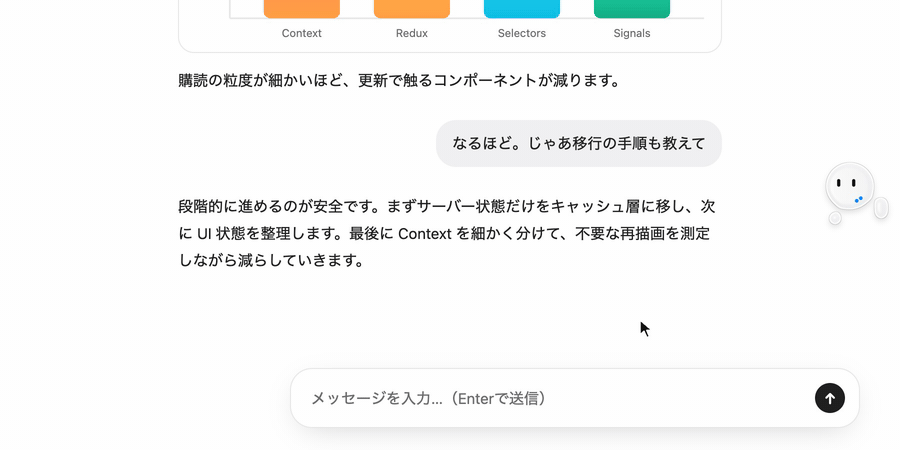
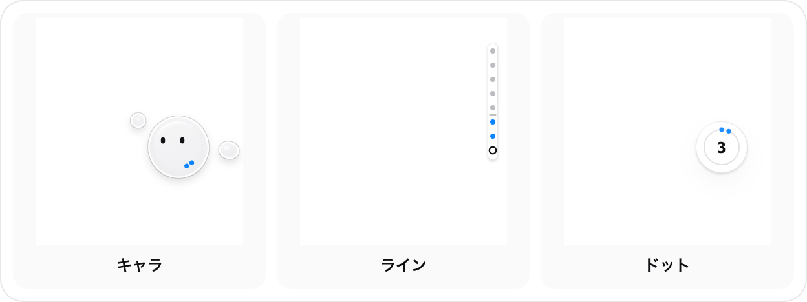
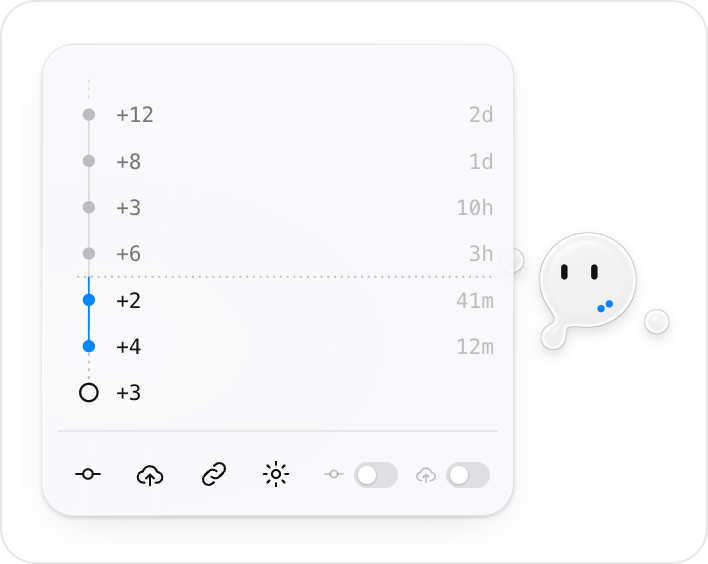
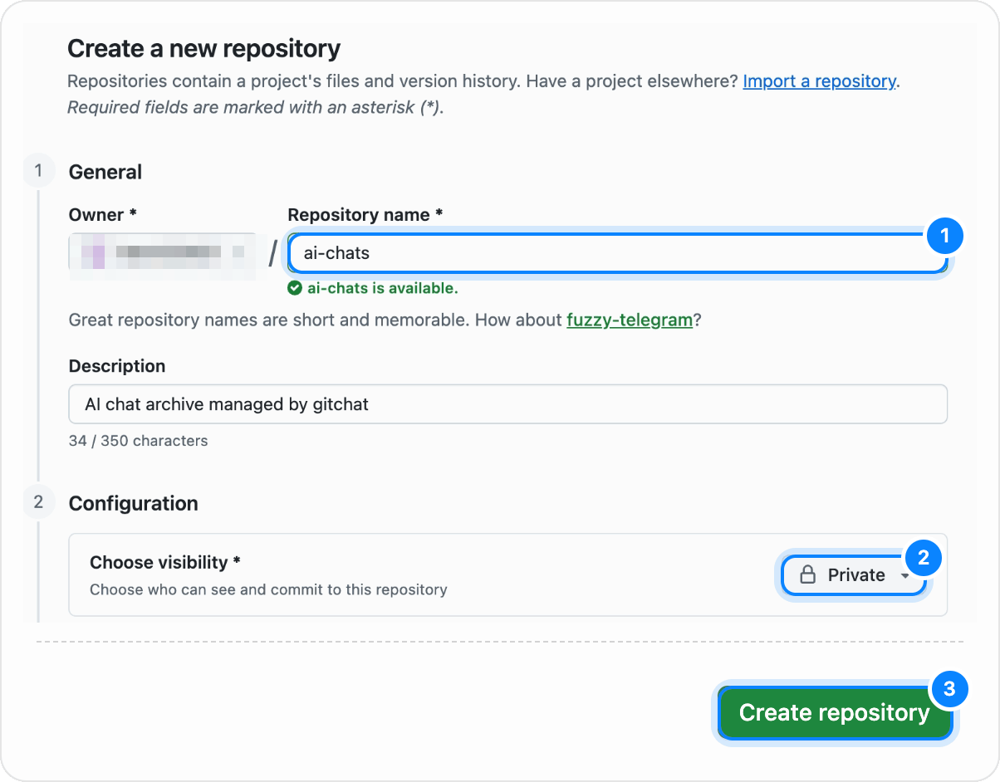
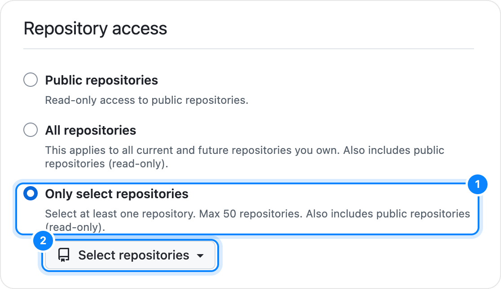
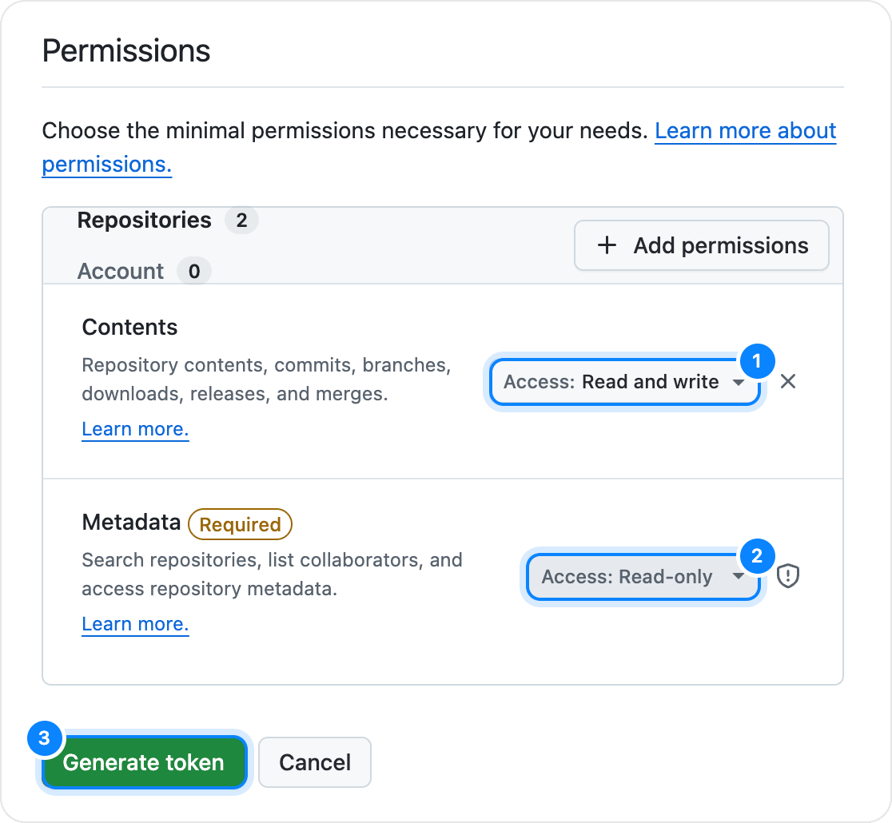

<p align="center">
  
</p>

<h1 align="center">gitchat</h1>

<p align="center">
  ChatGPT・Claude・Gemini の会話を、自分の GitHub リポジトリへ。<br>
  1 チャット = 1 つの Markdown。git と同じ <b>ステージ → コミット → プッシュ</b> で保存します。
</p>

<p align="center">
  <a href="https://github.com/Aero123421/gitchat/releases/latest"></a>
  <a href="https://github.com/Aero123421/gitchat/actions/workflows/ci.yml"></a>
  <a href="LICENSE"></a>
  
</p>

<p align="center"><a href="README.md">English</a> · <b>日本語</b></p>

<p align="center">
  
</p>

## gitchat とは

AI との良い会話は、残しておきたいし、次のツールにもそのまま渡したいもの。gitchat はチャットを 1 つずつ Markdown ファイルにして、あなたの GitHub リポジトリに保存します。Claude Code などのエージェントや同僚には、コピペの代わりにリンクを 1 つ渡すだけ。履歴はブラウザや PC をまたいで残ります。

## 使い心地

チャット画面の右端に、小さなウィジェットがいます。

- **ステージ**: AI が回答を終えると、新しいメッセージがウィジェットの周りに滴として現れます。まだ保存はされていません。
- **コミット**: ウィジェットにマウスを乗せてコミットを押すと、滴が取り込まれて青い点になります。青い点は、まだ GitHub に送っていないコミットの数です。
- **プッシュ**: プッシュを押すと青い点が飛び立ち、チャットのファイルがリポジトリに届きます。
- **パネル**: ウィジェットをクリックすると、そのチャットのコミットグラフ（上ほど古く、点線から上は GitHub にあるもの）、GitHub のリンクをコピーするボタン、**自動コミット**・**自動プッシュ** のスイッチが開きます。自動にした操作のボタンは非表示になります。

<p align="center">
  
  &nbsp;
  
</p>

スタイルは 3 種類。どれもモノクロのガラスに青のアクセントひとつです。**キャラ**（初期設定。AI が考えている間は一緒に考え、操作に反応します）・**ライン**・**ドット** から設定で選べます。

## 主な機能

- **1 チャット = 1 つの Markdown**: `chatgpt/`・`claude/`・`gemini/` フォルダに `<日付>-<タイトル>--<ID>.md` で保存。YAML フロントマターと `## User` / `## Assistant` の見出しで構成されます。
- **技術的な会話もそのまま**: 見出し、リスト、リンク、表、言語付きのコードブロック、TeX に戻した数式（`$…$`・`$$…$$`）に加え、Claude のアーティファクト・ChatGPT の可視化・Gemini の Canvas は HTML ファイルとしてチャットの横に保存します。
- **過去の履歴もまとめて**: **このチャットの保存を始める** を押したチャットだけが保存対象です。開始すると一番上までスクロールし、古いメッセージの読み込みを待って全体を読み取り、スクロール位置を元に戻します。一時チャットは保存しません。
- **複数の PC でも衝突なし**: プッシュは fast-forward のみ。別の PC が先にプッシュしていれば自動でその上に積み直し、同じチャットを両方で変更した場合はメッセージ単位で統合します。
- **編集や再生成にも対応**: 古い分岐は新しい分岐に置き換わります。ページと保存内容が合わなくなったときは、会話全体を自動で読み直します。
- **データはあなたのもの**: 独自サーバーも解析ツールもありません。チャットはブラウザから GitHub API を通じて、あなたのリポジトリへ直接送られます。

## インストール

Chrome 120 以降が必要です。Chrome ウェブストアにはまだ公開していません。

1. [最新リリース](https://github.com/Aero123421/gitchat/releases/latest) から `gitchat-<version>.zip` をダウンロードし、残しておくフォルダに展開します。
2. `chrome://extensions` を開き、右上の **デベロッパー モード** をオンにします。
3. **パッケージ化されていない拡張機能を読み込む** をクリックし、展開したフォルダを選びます。

<details>
<summary>ソースコードからビルドする場合</summary>

Node.js 22.12 以降が必要です。

```sh
git clone https://github.com/Aero123421/gitchat.git
cd gitchat
npm install
npm run build
```

`dist/` フォルダを **パッケージ化されていない拡張機能を読み込む** で読み込みます。

</details>

## 初期設定（約 3 分）

インストールすると設定ページが自動で開きます（ツールバーの gitchat アイコン → **セットアップ** からも開けます）。

1. **チャット用の非公開リポジトリを作成**: 設定ページから、名前 `ai-chats` と **Private** が選ばれた状態の GitHub のフォームが開きます。**Create repository** を押します。
2. **そのリポジトリ専用の fine-grained トークンを作成**: 名前と **Contents: Read and write** の権限が入力済みのフォームが開きます。**Repository access** で **Only select repositories** を選んでリポジトリを指定し、**Generate token** を押してトークンをコピーします。
3. **トークンを設定ページに貼り付け**: トークンはこの PC にだけ保存されます。
4. **リポジトリとウィジェットのスタイルを選択**: 必要なら自動コミット・自動プッシュもオンにします。
5. **チャットを開く**: ChatGPT・Claude・Gemini のチャットで右端のウィジェットにマウスを乗せ、**このチャットの保存を始める** を押します。

<details>
<summary>GitHub の画面はこうなります</summary>
<br>







</details>

詳しい手順は [はじめに](docs/getting-started.ja.md)、うまくいかないときは [トラブルシューティング](docs/troubleshooting.ja.md) をご覧ください。

## リポジトリに保存されるもの

```text
ai-chats/
├── chatgpt/
│   └── 2026-11-09-state-management-design--1a2b3c4d.md
├── claude/
│   ├── 2026-11-08-fourier-intuition--9f8e7d6c.md
│   └── 2026-11-08-fourier-intuition--9f8e7d6c.assets/
│       └── chart-1f2e.html
└── gemini/
    └── 2026-11-07-kyoto-trip--5a6b7c8d.md
```

```markdown
---
gitchat: 1
service: chatgpt
id: "1a2b3c4d-5e6f-4a7b-8c9d-0e1f2a3b4c5d"
url: "https://chatgpt.com/c/1a2b3c4d-5e6f-4a7b-8c9d-0e1f2a3b4c5d"
title: "状態管理の設計"
created: 2026-11-09T09:12:00.000Z
captured: 2026-11-09T10:40:00.000Z
messages: 6
---

# 状態管理の設計

## User
<!-- gitchat:message id="…" length="…" -->

React の状態管理、どう設計するのがいい？

## Assistant
<!-- gitchat:message id="…" length="…" -->

サーバーのデータが多いなら、まず **サーバー状態** と **UI 状態** を分けるのがおすすめです。…
```

見出しの下の隠しコメントがメッセージの ID を保持しているので、別の PC でも同じファイルの続きから保存できます。詳しくは [仕組み](docs/how-it-works.ja.md) をご覧ください。

## プライバシー

- **中継サーバーなし**: gitchat は独自のサーバー、アクセス解析、テレメトリを一切持ちません。会話データはブラウザから `api.github.com` へ直接送信されます。
- **トークンは端末内にのみ保存**: GitHub のトークンはその端末の `chrome.storage.local` にのみ保存され、他の端末へ同期されることはありません。また、バックグラウンドの Service Worker から外に出ることはなく、`github.com` と `api.github.com` への通信にのみ使われます。fine-grained 個人アクセストークンを使えば、権限をチャット保存用の非公開リポジトリ 1 つだけに限定できます。
- **設定のみを同期**: トークンを含まない設定項目（ウィジェットのスタイル、リポジトリ名、自動コミット・自動プッシュ、有効なサービスなど）のみが Chrome アカウント（`chrome.storage.sync`）を通じて同期されます。

データの保存場所と拡張機能の権限については [プライバシー](docs/privacy.ja.md) を参照してください。

## 対応サイト

| サービス | ホスト | 保存される内容 | 既知の制限事項 |
| --- | --- | --- | --- |
| ChatGPT | `chatgpt.com`（新 UI・旧 UI・Work モード） | テキスト、見出し、リスト、リンク、表（揃え位置を含む）、言語付きコードブロック、TeX 数式（`$...$`, `$$...$$`）、画面上に表示中のインライン可視化（`*.web-sandbox.oaiusercontent.com`、レンダリング済み HTML として保存） | 一時チャットは保存されません。Web 検索の引用ピルはページ内に URL が含まれないためソース名のみ保持されます。インライン可視化は元のソースではなくレンダリング済み HTML として保存されます。推論サマリーは除外されます。編集された会話は現在表示中のブランチのみ保存されます。 |
| Claude | `claude.ai` | テキスト、見出し、リスト、リンク、表（揃え位置を含む）、言語付きコードブロック、TeX 数式（`$...$`, `$$...$$`）、画面上に開いているアーティファクト（`*.claudeusercontent.com`、レンダリング済み HTML として保存） | アーティファクトの HTML を保存するには、取り込み時にサイドパネルで開いている必要があります。編集された会話は現在表示中のブランチのみ保存されます。 |
| Gemini | `gemini.google.com`（通常のチャットおよび Gem） | テキスト、見出し、リスト、リンク、表（揃え位置を含む）、言語付きコードブロック、TeX 数式（`$...$`, `$$...$$`）、画面上に表示中の Canvas プレビュー（`*.scf.usercontent.goog`、レンダリング済み HTML として保存） | Web 検索の引用リンクはメッセージ DOM に含まれません。Canvas プレビューは元のソースではなくレンダリング済み HTML として保存され、取り込み時に画面上に表示されている必要があります。編集された会話は現在表示中のブランチのみ保存されます。 |

3 つのサービスすべてにおいて、34〜40 ターンの実チャットで全文取り込み（init）を検証済みです（所要時間は約 4〜11 秒）。

## 開発

Node.js 22.12 以降が必要です（ウィジェットのプレイグラウンドを開く場合は Python 3 も使用します）。

| コマンド | 内容 |
| --- | --- |
| `npm install` | 依存パッケージのインストール |
| `npm run build` | `dist/` へ拡張機能をビルド（バンドルのみ・非圧縮） |
| `npm run dev` | `src/` の変更を監視して `dist/` を自動再ビルド |
| `npm test` | Vitest によるユニットテストおよびサイトアダプタのフィクスチャテストを実行 |
| `npm run typecheck` | TypeScript で `src/` と `tests/` の型チェックを実行 |
| `npm run zip` | ビルドして `dist/` を `gitchat-<version>.zip` にパッケージング |
| `npm run playground` | `http://localhost:5180/playground/` でウィジェット単体のプレイグラウンドを起動 |
| `npm run icons` | `src/shared/creature-art.js` から拡張機能のアイコンと README のロゴを生成（インストール済みの Google Chrome を使用。場所が違う場合は `CHROME_PATH` を指定） |

### ディレクトリ構成

| パス | 役割 |
| --- | --- |
| `src/shared/` | ドメイン型定義、型付きメッセージプロトコル（`protocol.ts`）、設定の初期値、i18n |
| `src/background/` | Service Worker: GitHub 認証・Git Data API クライアント、IndexedDB ストア、ステージング、ローカルコミット、マルチデバイス同期エンジン、Markdown ファイル生成 |
| `src/content/` | コンテンツスクリプト: サイトアダプタ（`adapters/`）、DOM から Markdown への変換（`capture/`）、AI 状態の監視、全文取り込み（init）、Shadow DOM ウィジェット |
| `src/content/ui/` | フレームワーク非依存の UI キット: ガラス表現、スプリング物理演算、3 種類のウィジェット（`creature`, `line`, `dot`）、コミットグラフパネル |
| `src/frame/` | 可視化用 iframe 内で動作し、親ページの要求に応じてレンダリング済み HTML を返すスクリプト |
| `src/popup/` | ツールバーのポップアップ（現在のチャットの状態、コミットグラフ、クイック操作） |
| `src/options/` | 設定ページおよび初回セットアップウィザード |
| `tests/` | Vitest テストスイートおよび匿名化済みの実サイト DOM フィクスチャ（`tests/fixtures/`） |

内部設計の契約については [DESIGN.md](DESIGN.md)、各チャットサイトの HTML 変更時にセレクタを更新する手順については [docs/site-adapters.md](docs/site-adapters.md)（英語）を参照してください。

## コントリビュート

バグ報告、機能改善、サイトアダプタの更新を歓迎します。[CONTRIBUTING.md](CONTRIBUTING.md)、[docs/site-adapters.md](docs/site-adapters.md)、[行動規範 (CODE_OF_CONDUCT.md)](CODE_OF_CONDUCT.md) をご確認ください。セキュリティ上の問題の報告については [SECURITY.md](SECURITY.md) を参照してください。

## ライセンス

[MIT](LICENSE)
