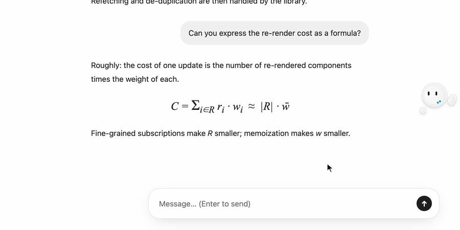
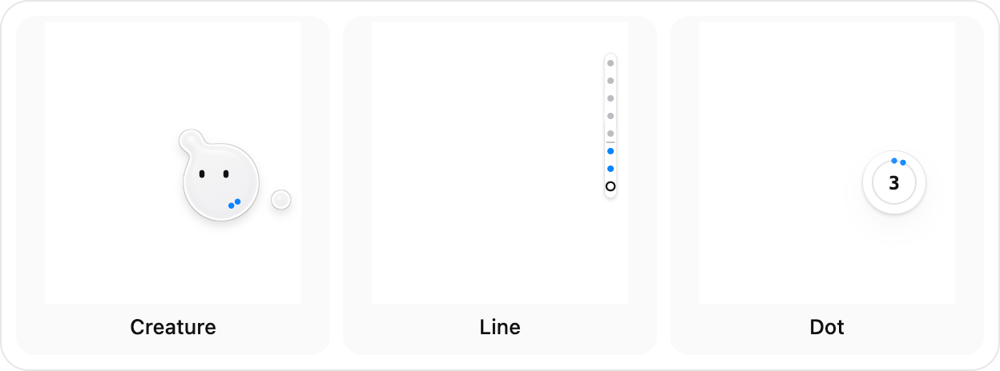
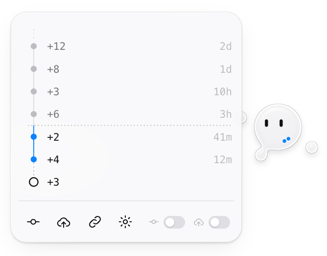
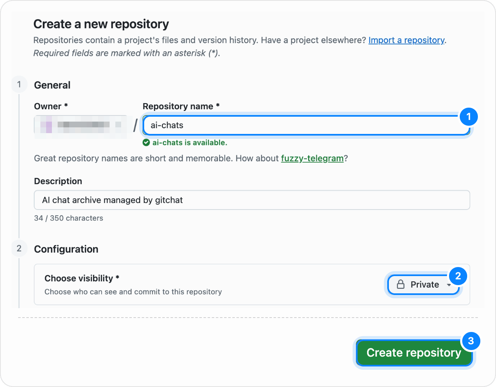
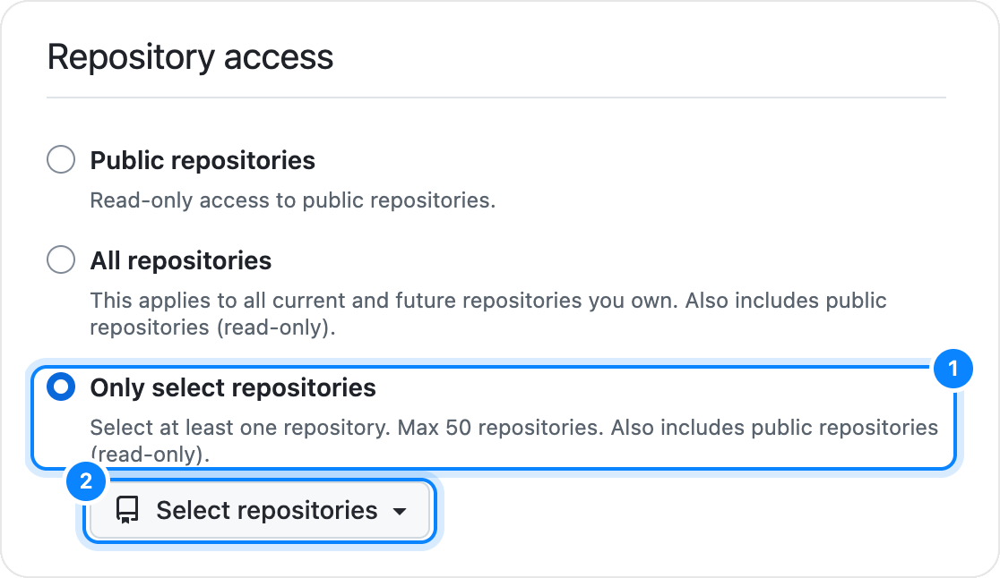
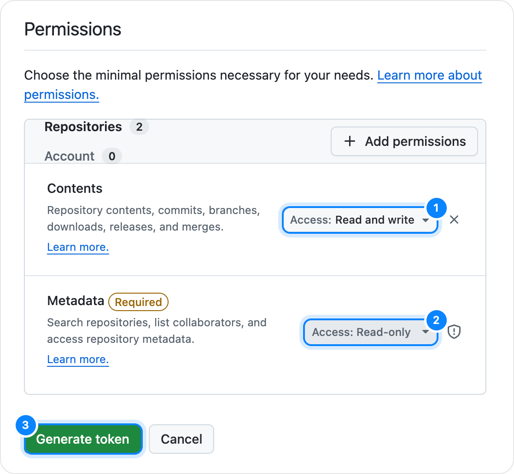

<p align="center">
  
</p>

<h1 align="center">gitchat</h1>

<p align="center">
  Save your ChatGPT, Claude and Gemini chats to your own GitHub repository,<br>
  one Markdown file per chat, with a git-like <b>stage → commit → push</b>.
</p>

<p align="center">
  <a href="https://github.com/Aero123421/gitchat/releases/latest"></a>
  <a href="https://github.com/Aero123421/gitchat/actions/workflows/ci.yml"></a>
  <a href="LICENSE"></a>
  
</p>

<p align="center"><b>English</b> · <a href="README.ja.md">日本語</a></p>

<p align="center">
  
</p>

## Why gitchat

A good AI conversation is worth keeping, and worth handing to the next tool. gitchat turns each chat into a Markdown file in a GitHub repository you own. Give Claude Code, another agent or a colleague one link instead of copy-pasting, and keep a history that survives across browsers and computers.

## How it feels

A small widget sits at the right edge of the chat page.

- **Stage**: when the AI finishes an answer, the new messages appear as droplets next to it. Nothing is saved yet.
- **Commit**: hover the widget and press Commit. The droplets merge in and become blue dots, one per commit not yet on GitHub.
- **Push**: press Push and the dots rise away: the chat file is in your repository.
- **Panel**: click the widget for the chat's commit graph (oldest at the top; the dotted line marks what is already on GitHub), a button to copy the file's GitHub link, and the **Auto commit** and **Auto push** switches. While a switch is on, its button is hidden.

<p align="center">
  
  &nbsp;
  
</p>

Three styles, all monochrome glass with one blue accent: **Creature** (the default; it watches the AI think and reacts to what you do), **Line** and **Dot**.

## Features

- **One chat, one Markdown file** in `chatgpt/`, `claude/` and `gemini/`, named `<date>-<title>--<id>.md`, with YAML front matter and `## User` / `## Assistant` sections.
- **Faithful for technical chats**: headings, lists, links, tables, code blocks with their language, math restored to TeX (`$…$`, `$$…$$`), and interactive visualizations (Claude artifacts, ChatGPT visualizations, Gemini Canvas) saved as HTML files next to the chat.
- **Whole history on demand**: a chat is saved once you press **Start saving this chat**. gitchat scrolls to the top, waits while the site loads older messages, reads everything and puts your scroll position back. Temporary chats are never saved.
- **Several computers, no conflicts to resolve**: pushes are fast-forward only. If another computer pushed first, gitchat replays on top; if both changed the same chat, the two are merged message by message.
- **Edits and regenerated answers** replace the old branch of the conversation; when the page no longer matches what was saved, gitchat reads the whole chat again on its own.
- **Your data stays yours**: no servers, no analytics. Chats go from your browser straight to your repository through the GitHub API.

## Install

gitchat requires Chrome 120 or later. It is not on the Chrome Web Store yet.

1. Download `gitchat-<version>.zip` from the [latest release](https://github.com/Aero123421/gitchat/releases/latest) and unzip it to a folder you keep.
2. Open `chrome://extensions` and turn on **Developer mode** (top right).
3. Click **Load unpacked** and select the unzipped folder.

<details>
<summary>Build from source instead</summary>

Requires Node.js 22.12 or later:

```sh
git clone https://github.com/Aero123421/gitchat.git
cd gitchat
npm install
npm run build
```

Then load the `dist/` folder with **Load unpacked**.

</details>

## Set up (about 3 minutes)

The setup page opens by itself after installing (or click the gitchat icon in the toolbar, then **Set up**).

1. **Create a private repository for your chats.** The setup page opens GitHub's form with the name `ai-chats` and **Private** already chosen; press **Create repository**.
2. **Create a fine-grained token for that repository only.** The setup page opens GitHub's form with the name and the **Contents: Read and write** permission filled in. Under **Repository access**, choose **Only select repositories** and pick the repository, then **Generate token** and copy it.
3. **Paste the token** into the setup page. It is stored only on this computer.
4. **Pick the repository and a widget style**, and optionally turn on Auto commit / Auto push.
5. **Open a chat** on ChatGPT, Claude or Gemini, hover the widget at the right edge, and press **Start saving this chat**.

<details>
<summary>What the GitHub pages look like</summary>
<br>







</details>

The [Getting started](docs/getting-started.md) guide walks through every step; [Troubleshooting](docs/troubleshooting.md) helps when something does not work.

## What ends up in your repository

```text
ai-chats/
├── chatgpt/
│   └── 2026-11-09-state-management-design--1a2b3c4d.md
├── claude/
│   ├── 2026-11-08-fourier-intuition--9f8e7d6c.md
│   └── 2026-11-08-fourier-intuition--9f8e7d6c.assets/
│       └── chart-1f2e.html
└── gemini/
    └── 2026-11-07-kyoto-trip--5a6b7c8d.md
```

```markdown
---
gitchat: 1
service: chatgpt
id: "1a2b3c4d-5e6f-4a7b-8c9d-0e1f2a3b4c5d"
url: "https://chatgpt.com/c/1a2b3c4d-5e6f-4a7b-8c9d-0e1f2a3b4c5d"
title: "State management design"
created: 2026-11-09T09:12:00.000Z
captured: 2026-11-09T10:40:00.000Z
messages: 6
---

# State management design

## User
<!-- gitchat:message id="…" length="…" -->

How should I structure state in a mid-size React app?

## Assistant
<!-- gitchat:message id="…" length="…" -->

With mostly server data, separate **server state** from **UI state** first. …
```

The hidden comment under each heading keeps the message's identity, so another computer can continue the same file. See [How it works](docs/how-it-works.md) for the details.

## Privacy

- **No middleman**: gitchat operates no servers, analytics, or telemetry. Conversations go directly from your browser to `api.github.com`.
- **Local token storage**: your GitHub token is stored only in `chrome.storage.local` on that device, is never synced across devices, never leaves the background service worker except in requests to `github.com` and `api.github.com`, and can be scoped to a single private repository using a fine-grained personal access token.
- **Synced preferences only**: non-secret settings (widget style, repository name, auto-commit/push switches, enabled services) sync through your Chrome profile (`chrome.storage.sync`).

For a full breakdown of storage locations and extension permissions, see [Privacy](docs/privacy.md).

## Supported sites

| Service | Host | What is captured | Known limits |
| --- | --- | --- | --- |
| ChatGPT | `chatgpt.com` (new UI, classic UI, Work mode) | Text, headings, lists, links, tables (with alignment), fenced code blocks with language, TeX math (`$...$`, `$$...$$`), inline visualizations (`*.web-sandbox.oaiusercontent.com`) as rendered HTML when on screen | Temporary chats are never saved. Web-search citation pills keep the source name only (URLs are not in the page DOM). Inline visualizations are saved as rendered HTML, not original source. Reasoning summaries are excluded. Only the currently shown branch of an edited chat is saved. |
| Claude | `claude.ai` | Text, headings, lists, links, tables (with alignment), fenced code blocks with language, TeX math (`$...$`, `$$...$$`), open artifacts (`*.claudeusercontent.com`) as rendered HTML when on screen | An artifact must be open in the side panel at capture time to save its HTML. Only the currently shown branch of an edited chat is saved. |
| Gemini | `gemini.google.com` (standard chats and Gems) | Text, headings, lists, links, tables (with alignment), fenced code blocks with language, TeX math (`$...$`, `$$...$$`), Canvas previews (`*.scf.usercontent.goog`) as rendered HTML when on screen | Web-search citations are not in the message DOM. Canvas previews are saved as rendered HTML, not original source, and must be on screen at capture time. Only the currently shown branch of an edited chat is saved. |

Verified on 34–40-turn conversations across all three services (full-history init completes in roughly 4–11 seconds).

## Development

Requires Node.js 22.12+ (and Python 3 for the widget playground).

| Command | Description |
| --- | --- |
| `npm install` | Install dependencies |
| `npm run build` | Bundle the extension into `dist/` (bundled, unminified) |
| `npm run dev` | Watch `src/` and rebuild `dist/` on change |
| `npm test` | Run Vitest unit and adapter fixture tests |
| `npm run typecheck` | Type-check `src/` and `tests/` with TypeScript |
| `npm run zip` | Build and package `dist/` into `gitchat-<version>.zip` |
| `npm run playground` | Serve the widget playground at `http://localhost:5180/playground/` |
| `npm run icons` | Render the extension icons and the README logo from `src/shared/creature-art.js` (uses your installed Google Chrome; set `CHROME_PATH` if needed) |

### Code layout

| Path | Role |
| --- | --- |
| `src/shared/` | Domain types, typed message protocol (`protocol.ts`), settings defaults, i18n |
| `src/background/` | Service worker: GitHub auth and Git Data API client, IndexedDB store, staging, local commits, multi-device sync engine, Markdown file rendering |
| `src/content/` | Content script: site adapters (`adapters/`), DOM-to-Markdown capture (`capture/`), AI state observer, full-history init, Shadow DOM widget host |
| `src/content/ui/` | Framework-free ES module UI kit: liquid-glass primitives, spring physics, the three widgets (`creature`, `line`, `dot`), and the commit-graph panel |
| `src/frame/` | Helper script running in visualization iframes to serialize rendered HTML on request |
| `src/popup/` | Toolbar popup showing current chat status, commit graph, and quick actions |
| `src/options/` | Settings page and first-run onboarding wizard |
| `tests/` | Vitest suite and sanitized live-site DOM fixtures (`tests/fixtures/`) |

See [DESIGN.md](DESIGN.md) for the internal architecture contract and [Site adapters](docs/site-adapters.md) for how to update selectors when a chat site changes its HTML.

## Contributing

Contributions, bug reports, and adapter updates are welcome. Please read [CONTRIBUTING.md](CONTRIBUTING.md), [docs/site-adapters.md](docs/site-adapters.md), and our [Code of conduct](CODE_OF_CONDUCT.md). To report a security vulnerability, please follow [SECURITY.md](SECURITY.md).

## License

[MIT](LICENSE)
