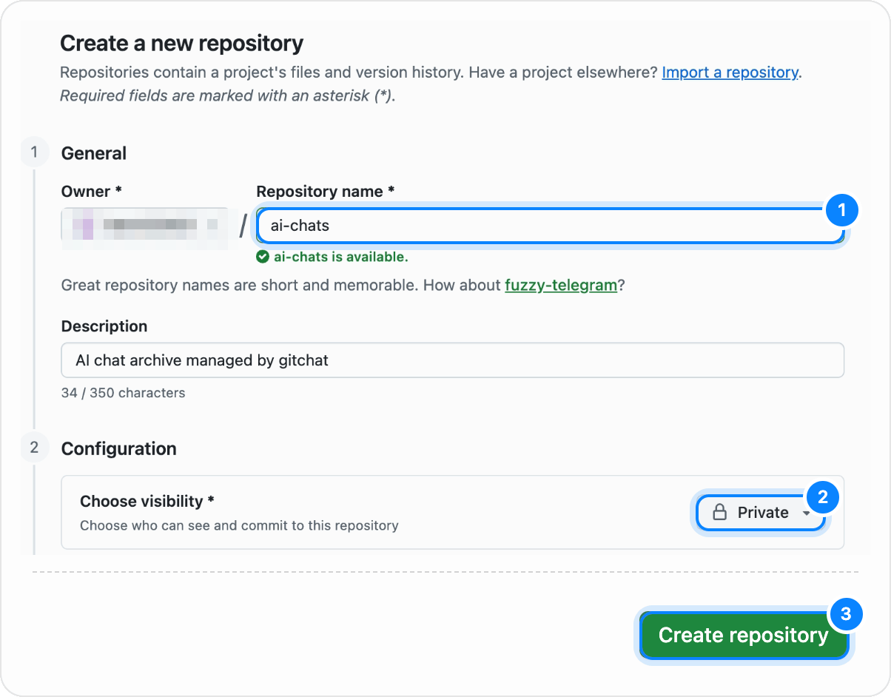
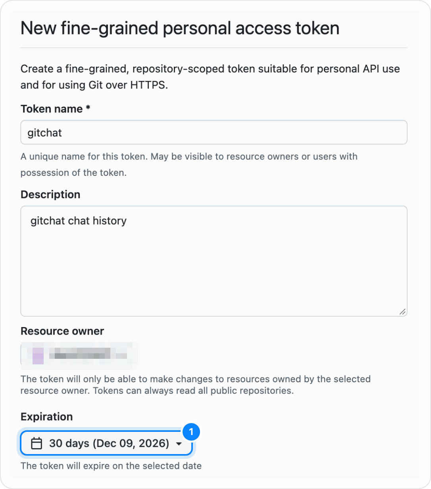
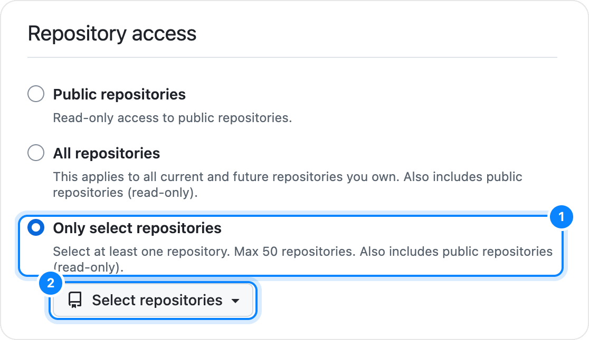
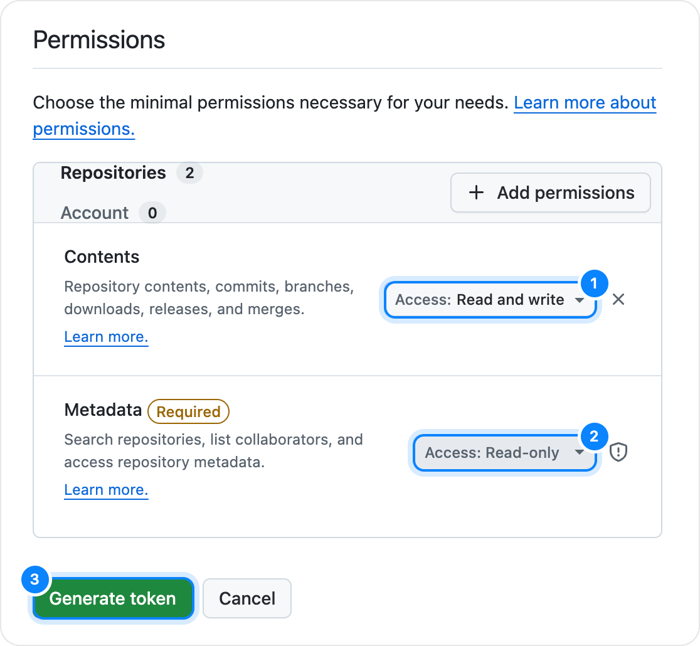

# はじめに

[English](getting-started.md)

このガイドでは、gitchat のインストールから GitHub アカウントの接続、保存先リポジトリの選択、そして ChatGPT・Claude・Gemini の会話を実際に保存するまでの手順を説明します。

## 1. 拡張機能をインストールする

gitchat の動作には Chrome 120 以降が必要です。Chrome ウェブストアでの公開までは、パッケージ化されていない拡張機能として読み込みます。

### 方法 A: git で入れる（おすすめ）

読み込める状態の拡張機能を、リポジトリの `dist` ブランチに置いています。リリースのたびに自動で更新されます。

1. 残しておくフォルダにダウンロードします（Chrome は起動のたびにこのフォルダから読み込みます）。

   ```sh
   git clone -b dist https://github.com/Aero123421/gitchat.git ~/gitchat-extension
   ```

2. Chrome で `chrome://extensions` を開き、右上の **デベロッパー モード** をオンにします。
3. **パッケージ化されていない拡張機能を読み込む** をクリックし、`gitchat-extension` フォルダを選びます。

**更新** はコマンド 1 つと再読み込みだけです。

```sh
git -C ~/gitchat-extension pull
```

`chrome://extensions` で gitchat の再読み込みボタンを押すか、gitchat の設定 → **情報** の **再読み込み** を押し、開いているチャットのタブも再読み込みします。同じフォルダから読み込んでいる限り、サインイン・設定・保存済みのチャットは Chrome がそのまま保持します。以前 zip で入れていた場合は、古いフォルダを別名に移してから、そのとき読み込んだのと同じ場所に clone するとデータを引き継げます。

### 方法 B: リリースの zip ファイルから読み込む

[GitHub Releases](https://github.com/Aero123421/gitchat/releases) から `gitchat-<version>.zip` をダウンロードして残しておくフォルダに展開し、上と同じ方法で読み込みます。更新するときは、フォルダの中身を次のリリースのものに置き換えて再読み込みします。

### 方法 C: ソースコードからビルドする

Node.js 22.12 以降が必要です。

```sh
git clone https://github.com/Aero123421/gitchat.git
cd gitchat
npm install
npm run build
```

`chrome://extensions` で **デベロッパー モード** をオンにし、**パッケージ化されていない拡張機能を読み込む** でリポジトリ内の `dist/` フォルダを選びます。更新は `git pull && npm install && npm run build` のあと再読み込みします。

## 2. セットアップウィザードを完了する

初回インストール時には、新しいタブでセットアップウィザードが自動的に開きます。ブラウザのツールバーにある gitchat アイコンをクリックし、**セットアップ**（または **セットアップを完了**）を押していつでも開くこともできます。

### ステップ 1: GitHub と接続

GitHub との接続には 2 つの方法があります。

- **個人アクセストークン（推奨: 1 つのリポジトリだけに権限を限定できます）**。gitchat に 3 つの手順が表示されます（サインインボタンが表示されている場合は、先に **トークンを使う** をクリックします）。
  1. **GitHub でリポジトリを作成** をクリックすると、名前 `ai-chats` と **Private** が入力された状態で GitHub のリポジトリ作成画面が開きます。README・`.gitignore`・ライセンスは追加せず、空のまま作成してください。1 つのリポジトリに限定したトークンではリポジトリを作成できないため、先にリポジトリを用意します。

     

  2. **GitHub でトークンを作成** をクリックすると、名前と **Contents: Read and write** の権限が入力された状態で fine-grained トークンの作成画面が開きます（**Metadata: Read-only** は自動で付きます）。有効期限はそのままでも変更しても構いません。期限が切れたら、新しいトークンを作って貼り直してください。**Repository access** で **Only select repositories** を選び、手順 1 のリポジトリを指定します。

     

     

     

  3. **Generate token** を押し、一度だけ表示される `github_pat_...` で始まる文字列をコピーして gitchat に貼り付け、**接続** をクリックします。対象のリポジトリが違うときは、戻って別のトークンを使えます（GitHub のステップの **別のトークンを使う**、またはリポジトリのステップの **トークンが違いますか？別のトークンを使う**）。
- **GitHub でサインイン（OAuth Device Flow）**:
  - ビルドに OAuth クライアント ID が組み込まれている場合、または **設定 → 詳細 → GitHub OAuth クライアント ID** が設定されている場合に利用できます。
  - **GitHub でサインイン** をクリックし、画面に表示されたコードをコピーして **GitHub を開く** を押し、GitHub 上で承認すると自動的に接続が完了します。

トークンはこの端末の `chrome.storage.local` にのみ保存され、他の端末へ同期されることはありません。

### ステップ 2: 保存先のリポジトリを選ぶ

会話には個人的な内容や業務上の文脈が含まれることが多いため、**非公開（Private）** リポジトリの使用を強くおすすめします。

個人アクセストークンで接続した場合は、前の手順で作成したリポジトリが表示される **既存のリポジトリ** から始まります。

- **新しく作る**: リポジトリ名（初期値は `ai-chats`）を入力し、**非公開** をオンにしたまま **作成** をクリックします。リポジトリを作成できる接続（GitHub でサインイン、またはリポジトリ作成権限のあるトークン）が必要です。GitHub アカウント上にリポジトリが作成され、gitchat 管理下であることを示す `README.md` の初回コミットと `gitchat` トピックの設定が自動で行われます。
- **既存のリポジトリ**: 一覧からリポジトリを選んで **使う** をクリックします。一覧にない場合は、検索欄に `owner/name` を入力して選ぶこともできます。既存の別プロジェクトへ誤って書き込むのを防ぐため、gitchat が使用できるのは **空のリポジトリ** または **すでに gitchat が管理しているリポジトリ**（gitchat の `README.md`、または gitchat が書いたチャットファイルが `chatgpt/`・`claude/`・`gemini/` にあるもの）に限られます。それらのフォルダにある他の Markdown ファイルは対象になりません。

### ステップ 3: 見た目と動きを選ぶ

セットアップ画面の右端にウィジェットの実物プレビューが表示されるため、動きを確かめながら設定できます。

- **ウィジェットのスタイル**:
  - **キャラ（Creature・標準）**: すりガラス調の小さなキャラクターです。周りを回る水滴が未コミットのメッセージ、体内の青い粒が未プッシュのコミットを表します。
  - **ライン（Line）**: 画面右端に細長いカプセルを表示し、古いコミット（上）から新しいコミット（下）へとドットを並べ、一番下に未コミットを表すリングを表示します。
  - **ドット（Dot）**: 小さな円形のダイヤルです。中央の数字が未コミットのメッセージ数、外周の青い目盛りが未プッシュのコミット数を表します。
- **自動コミット** と **自動プッシュ**:
  - **自動コミット**: AI の回答が終わるたびに、ステージされたメッセージを自動でコミットします。
  - **自動プッシュ**: コミットの直後に自動でプッシュします。
  - **連動ルール**: **自動プッシュ** をオンにすると **自動コミット** も自動でオンになります。逆に **自動コミット** をオフにすると **自動プッシュ** も自動でオフになります。

**次へ** を押し、最後に **設定を開く**（または各チャットサービスのリンク）をクリックしてセットアップ完了です。

## 3. 最初のチャットを保存する

gitchat は開いたチャットを無差別に保存することはありません。すべてのチャットは、あなたが保存を始めるまで **未追跡（untracked）** の状態です。

1. [ChatGPT](https://chatgpt.com)、[Claude](https://claude.ai)、または [Gemini](https://gemini.google.com) で会話を開きます（新規チャットの場合は、最初のメッセージを送って会話 URL が発行されてから保存を開始できます）。
2. 画面右端のウィジェットにカーソルを合わせるか、ブラウザのツールバーから gitchat のポップアップを開きます。
3. ウィジェットの下に現れる **このチャットの保存を始める** ボタン（またはポップアップ内の同ボタン）をクリックします。
4. **全文の初回取り込み（init）**:
   - gitchat が会話領域を一番上までスクロールし、サイト側で過去のメッセージが段階的に読み込まれるのを待ちます。
   - 過去のメッセージを読み込んでいる間は件数（`↑ N`）、先頭まで到達して上から下へ読み取っている間はパーセンテージ（`0–100%`）で進捗が表示されます。
   - 途中でやめたい場合は、ウィジェット下の **キャンセル** ボタンでいつでも中断できます。
   - 読み取りが終わると元のスクロール位置に戻り、会話内のすべてのメッセージがステージされます。
5. **コミットとプッシュ**:
   - **自動コミット**・**自動プッシュ** がオフの場合は、ウィジェットにカーソルを合わせて **コミット** を押し、続けて **プッシュ** を押します（ウィジェットをクリックしてパネルを開いて操作することもできます）。
   - **プッシュ** を押すと、現在のチャットでステージされている変更が先にコミットされてから、未プッシュのローカルコミットがまとめて GitHub リポジトリへ送信されます。
   - **自動コミット** がオンのときは手動の **コミット** ボタンは表示されません。**自動プッシュ** がオンのときは **プッシュ** ボタンも非表示になります（プッシュがエラーになり再試行が必要なときだけ再表示されます）。

## 4. 会話を別のチャットや AI エージェントに渡す

チャットを保存してプッシュしたあとは、リンク 1 つで共有できます。

1. ページ上のウィジェットをクリックしてパネルを開くか、ツールバーのポップアップを開きます。
2. **GitHub のファイルへのリンクをコピー**（リンクアイコン）をクリックします。
3. コピーした URL を別のチャットに貼り付けるか、リポジトリ内のファイルを Claude Code などの AI エージェントに指定して読み込ませます。

リポジトリ内ではサービスごとのフォルダに整理されます。

```text
README.md
chatgpt/2026-11-09-state-design--a1b2c3d4.md
claude/2026-11-09-react-hooks--9f8e7d6c.md
claude/2026-11-09-react-hooks--9f8e7d6c.assets/viz-1.html
gemini/2026-11-09-query-planner--7c6b5a4d.md
```

## 5. 設定項目一覧

設定ページは、ウィジェットのパネル内の歯車アイコン、ツールバーのポップアップ、または `chrome://extensions` → **詳細** → **拡張機能のオプション** からいつでも開けます。

| セクション | 設定できる内容 |
| --- | --- |
| **アカウント (Account)** | 接続中の GitHub アカウント（`@login`）、認証方式（`GitHub でサインイン` または `個人アクセストークン`）、スコープの確認、およびこの端末からのサインアウト。 |
| **リポジトリ (Repository)** | 保存先リポジトリを GitHub で開く、別のリポジトリへ変更する、対象ブランチと現在の同期状態を確認する。 |
| **動作 (Behavior)** | **自動コミット**・**自動プッシュ** の切り替え、サービスごとの有効・無効（**ChatGPT**・**Claude**・**Gemini**）、**可視化を保存**（インタラクティブなグラフやアーティファクトの HTML を `<chat>.assets/` に保存、初期値はオン）の切り替え。 |
| **見た目 (Appearance)** | ライブプレビューを確認しながら、ページ上のウィジェットを **キャラ**・**ライン**・**ドット** の中から切り替え。テーマは **自動**（初期設定。ウィジェットはチャットサイトに、このページとポップアップはシステムの外観に合わせます）・**ライト**・**ダーク**。ツールバーのアイコンはテーマでは変わりません（Chrome ではアイコンを 1 つしか指定できないためです）。 |
| **詳細 (Advanced)** | 自分で管理する GitHub App / OAuth App（Device Flow 有効）を使うための **GitHub OAuth クライアント ID** の設定、および **設定をリセット**（リポジトリには一切触れず、この端末でのサインアウトと初期設定への復元を実行）。 |
| **情報 (About)** | バージョン、GitHub プロジェクトへのリンク、ライセンス（`MIT`）の確認。 |
