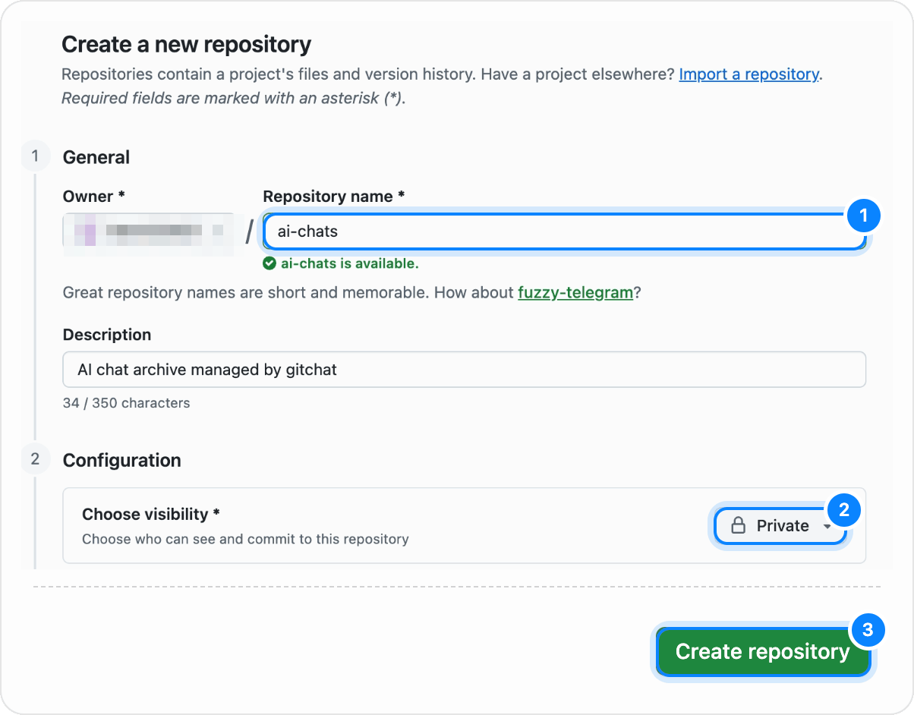
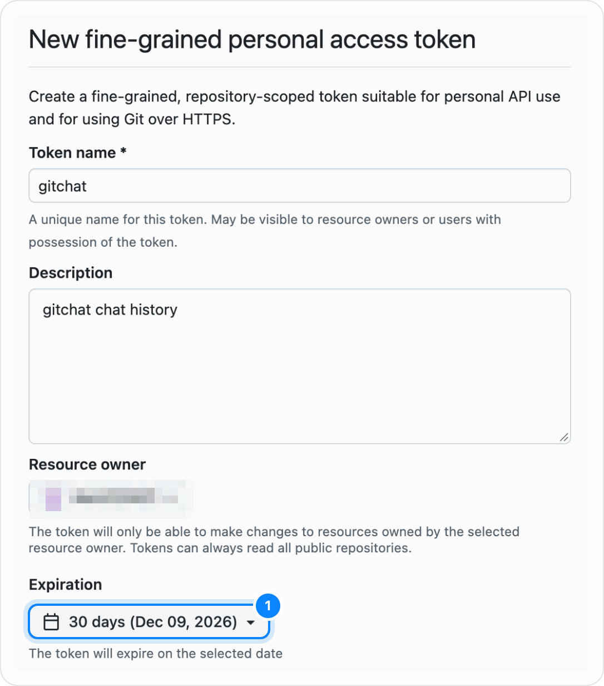
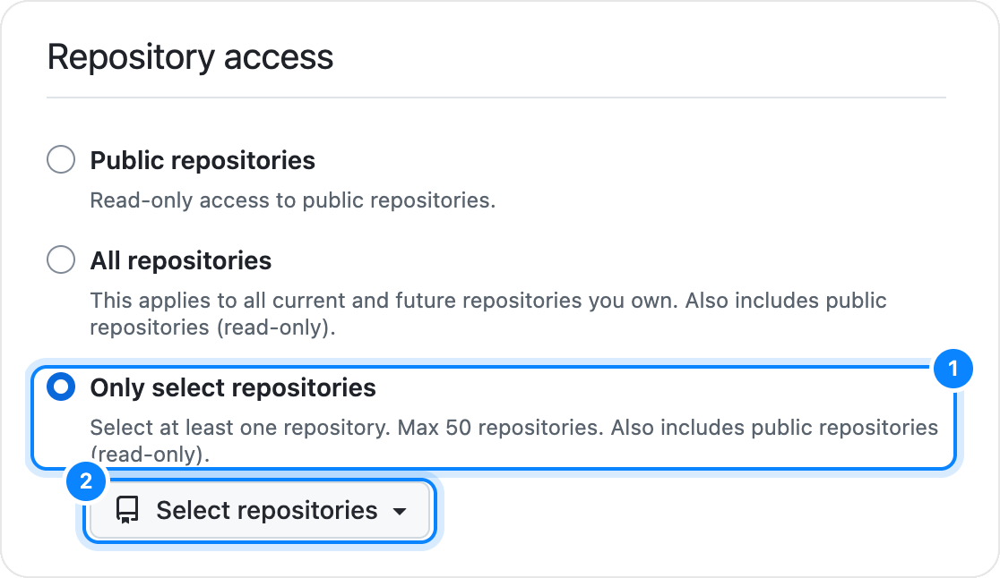
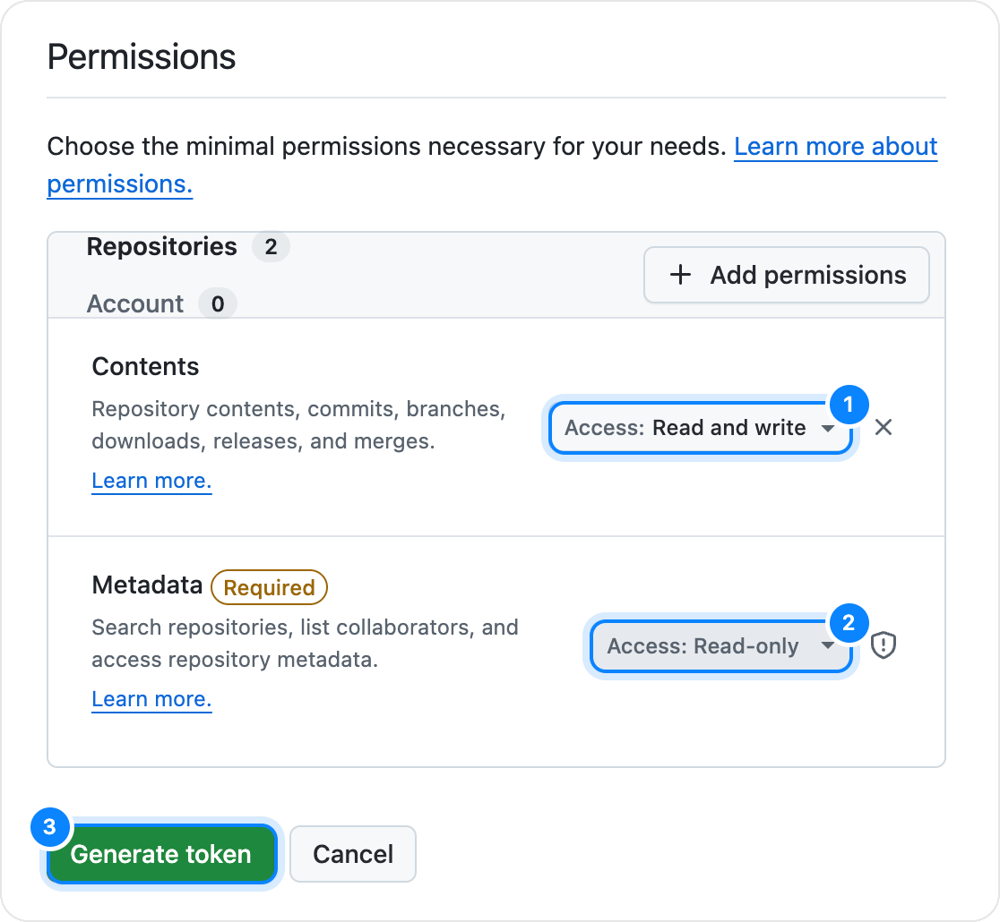

# Getting started

[日本語](getting-started.ja.md)

This guide walks through installing gitchat, connecting your GitHub account, choosing a repository, and saving your first conversation from ChatGPT, Claude, or Gemini.

## 1. Install the extension

gitchat requires Chrome 120 or later. Until it is listed on the Chrome Web Store, load it as an unpacked extension.

### Option A: With git (recommended)

The ready-to-load extension is kept on the repository's `dist` branch, updated with every release.

1. Download it to a permanent folder (Chrome reads unpacked extensions from disk whenever it starts):

   ```sh
   git clone -b dist https://github.com/Aero123421/gitchat.git ~/gitchat-extension
   ```

2. Open `chrome://extensions` in Chrome and turn on **Developer mode** in the top-right corner.
3. Click **Load unpacked** and select the `gitchat-extension` folder.

**Updating** is one command, then a reload:

```sh
git -C ~/gitchat-extension pull
```

Press gitchat's reload button in `chrome://extensions` (or **Reload** in gitchat's settings under **About**), then reload any open chat tabs. Chrome keeps your sign-in, settings and saved chats for as long as gitchat is loaded from the same folder. If you installed from a zip before, clone into the folder you loaded then (after moving the old one aside) to keep your data.

### Option B: From a release archive

Download `gitchat-<version>.zip` from [GitHub Releases](https://github.com/Aero123421/gitchat/releases), extract it to a permanent folder, and load that folder as above. To update, replace the folder's contents with the next release's and reload.

### Option C: Build from source

Requires Node.js 22.12 or later:

```sh
git clone https://github.com/Aero123421/gitchat.git
cd gitchat
npm install
npm run build
```

Then open `chrome://extensions`, enable **Developer mode**, click **Load unpacked**, and select the `dist/` folder inside the repository. To update, run `git pull && npm install && npm run build` and reload.

## 2. Complete the setup wizard

When gitchat is installed for the first time, it opens its setup wizard in a new tab. You can also open it at any time by clicking the gitchat icon in the browser toolbar and clicking **Set up** (or **Finish setup**).

### Step 1: Connect GitHub

gitchat supports two ways to authenticate with GitHub:

- **Personal access token (recommended: access to one repository only)**. gitchat shows three steps (click **Use a token instead** first if the sign-in button is shown):
  1. **Create a repository on GitHub** opens GitHub's new-repository form, pre-filled with the name `ai-chats` and **Private**. Create it empty (no README, `.gitignore` or license). A token limited to one repository cannot create repositories itself, so the repository comes first.

     

  2. **Create a token on GitHub** opens GitHub's fine-grained token form with the name and the **Contents: Read and write** permission pre-filled (**Metadata: Read-only** is added automatically). Keep or change the expiration; when it expires, create a new token and paste it again. Under **Repository access**, choose **Only select repositories** and pick the repository from step 1.

     

     

     

  3. Click **Generate token**, copy the `github_pat_...` string GitHub shows (only once), paste it into gitchat, and click **Connect**. If that token is for the wrong repository, you can go back and use a different one (**Use a different token** on the GitHub step, or **Wrong token? Use a different one** on the repository step).
- **Sign in with GitHub (OAuth device flow)**:
  - Available when an OAuth client ID is configured in the build or under **Settings → Advanced → GitHub OAuth client ID**.
  - Click **Sign in with GitHub**, copy the one-time device code shown on screen, click **Open GitHub**, and authorize the request. gitchat finishes signing in automatically once approved.

Your token is stored only in `chrome.storage.local` on this computer and is never synced to other devices.

### Step 2: Choose a repository

Because conversations often contain personal or work context, a **private** repository is strongly recommended.

When you connected with a personal access token, this step opens on **Existing repository**, where the repository from the previous step is listed.

- **New repository**: enter a repository name (default `ai-chats`), keep **Private** turned on, and click **Create**. This needs a sign-in that may create repositories (GitHub sign-in, or a token with repository creation access). gitchat creates the repository on your GitHub account, adds a short `README.md` noting that the archive is managed by gitchat, and tags the repository with the `gitchat` topic so your other devices can spot it easily.
- **Existing repository**: select an existing repository from the list and click **Use**, or type `owner/name` in the search box if it is not listed. To avoid writing into an unrelated project by mistake, gitchat only accepts repositories that are either **empty** or **already managed by gitchat** (containing gitchat's `README.md`, or chat files written by gitchat in `chatgpt/`, `claude/`, or `gemini/`). Other Markdown files in those folders do not count.

### Step 3: Choose how it looks and works

A live preview of the widget appears on the right edge of the setup page so you can try each option before finishing:

- **Widget style**:
  - **Creature** (default): a small frosted-glass creature whose orbiting droplets are uncommitted messages and whose internal blue dots are unpushed commits.
  - **Line**: a thin capsule along the screen edge showing the commit history as vertical dots from oldest (top) to newest (bottom), with a hollow ring at the bottom for uncommitted messages.
  - **Dot**: a small circular dial showing the uncommitted message count in the center and unpushed commits as blue ticks around the ring.
- **Auto commit** and **Auto push**:
  - **Auto commit**: commits staged messages automatically whenever the AI finishes an answer.
  - **Auto push**: pushes right after each commit.
  - **Coupling rule**: turning **Auto push** on also turns **Auto commit** on; turning **Auto commit** off also turns **Auto push** off.

Click **Continue**, then **Open settings** (or open ChatGPT, Claude, or Gemini directly) to finish setup.

## 3. Save your first conversation

gitchat does not save every chat you open. Every conversation starts as **untracked** until you explicitly start saving it.

1. Open an existing or new conversation on [ChatGPT](https://chatgpt.com), [Claude](https://claude.ai), or [Gemini](https://gemini.google.com) (on a brand-new chat, send the first message so the site assigns a conversation URL).
2. Hover the gitchat widget on the right edge of the page (or click the gitchat icon in the browser toolbar).
3. Click the **Start saving this chat** button under the widget (or in the popup).
4. **Initial capture (init)**:
   - gitchat scrolls the conversation to the very top and waits while the site loads older messages in batches.
   - Progress is shown first as a message count (`↑ N`) while older turns load, then as a percentage (`0–100%`) while gitchat reads the conversation from top to bottom.
   - You can click **Cancel** under the widget at any time to abort.
   - When complete, gitchat restores your scroll position and stages all messages in the conversation.
5. **Commit and push**:
   - If **Auto commit** and **Auto push** are off, hover the widget and click **Commit** (or open the widget panel by clicking the widget), then click **Push**.
   - Pressing **Push** automatically commits any staged messages for the current chat first, then pushes all pending local commits to your GitHub repository.
   - When **Auto commit** is on, the **Commit** button is hidden because commits happen automatically when each answer finishes. When **Auto push** is on, the **Push** button is also hidden (reappearing only if a push fails and needs a retry).

## 4. Hand a conversation to another chat or AI agent

Once a chat is tracked and pushed:

1. Click the on-page widget to open its panel (or open the toolbar popup).
2. Click **Copy link to the file on GitHub** (the link icon).
3. Paste the URL into another chat or pass the file in your repository to an AI agent such as Claude Code.

In your repository, files are organized by service:

```text
README.md
chatgpt/2026-11-09-state-design--a1b2c3d4.md
claude/2026-11-09-react-hooks--9f8e7d6c.md
claude/2026-11-09-react-hooks--9f8e7d6c.assets/viz-1.html
gemini/2026-11-09-query-planner--7c6b5a4d.md
```

## 5. Settings reference

Open the settings page at any time from the gear icon in the widget panel, the toolbar popup, or `chrome://extensions` → **Details** → **Extension options**.

| Section | What you can configure |
| --- | --- |
| **Account** | View the connected GitHub account (`@login`), authentication method (`GitHub sign-in` or `Personal access token`), and token scopes, or sign out on this device. |
| **Repository** | Open the configured repository on GitHub, switch to a different repository, view the target branch, and check the current sync status. |
| **Behavior** | Toggle **Auto commit** and **Auto push**; enable or disable gitchat per service (**ChatGPT**, **Claude**, **Gemini**); toggle **Save visualizations** (saves rendered HTML of interactive artifacts/charts in `<chat>.assets/`, on by default). |
| **Appearance** | Switch the on-page widget between **Creature**, **Line**, and **Dot** with an interactive preview. Set **Theme** to **Auto** (default; the widget follows the chat site, and this page and the popup follow the system), **Light**, or **Dark**. The toolbar icon cannot change with the theme (Chrome allows one icon). |
| **Advanced** | Set a custom **GitHub OAuth client ID** (to sign in through a GitHub App or OAuth App you control with Device Flow enabled), or click **Reset settings** to sign out on this device and restore default preferences without modifying your repository. |
| **About** | Extension version, link to the GitHub project, and license (`MIT`). |
